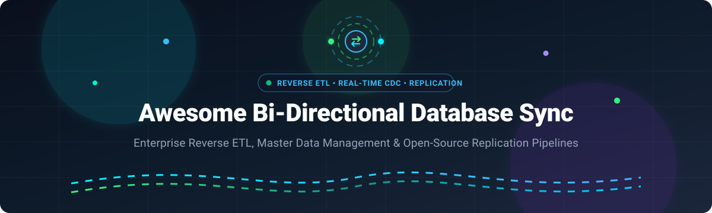

# Awesome-BI-Directional-Database-Synchronization

# Awesome-BI-Directional-Database-Synchronization 🔄 🗄️

  

  
  
  
  
  

---

## 🌟 Top Bi-Directional Database Synchronization Ecosystem

**Curated List of Commercial Reverse ETL Platforms & Open-Source Data Sync Frameworks**  
*Focused on Warehouse-to-SaaS Activation, Bi-Directional CRM Sync, Change Data Capture (CDC), Real-Time Multi-Master Replication & Self-Hosted Data Pipelines*

**Last updated: October 2026** 📅

---

### 📌 Overview & SEO Summary 🚀
Welcome to the comprehensive curated directory of **bi-directional database synchronization platforms**, **open-source Reverse ETL frameworks**, **change data capture (CDC) pipelines**, and **real-time database replication engines**. Whether you are architecting enterprise-grade data activations (such as *Heroku Connect*, *Hightouch*, and *Census*), or deploying self-hostable open-source bidirectional pipelines (like *Airbyte*, *Debezium*, *ElectricSQL*, *pgsync*, *SymmetricDS*, *ETLX*, and *lht*), this directory provides architectural comparisons, pricing benchmarks, and production-tested patterns.

**Key Market Context & Dynamics:** 📈
- **Heroku Connect** provides **bi-directional synchronization between Heroku Postgres and Salesforce** with point-and-click configuration, supporting all standard and custom Salesforce objects, read-only or read/write modes, and HIPAA-compliant Shield Connect plans [citation:2][citation:17].
- **Hightouch** offers a **free forever tier** with **1 standard destination and 2 active syncs**, scaling to **$350/month for 5 active syncs per destination**, with a **30-day free trial** on all additional destinations [citation:3].
- **Census (now Fivetran Activations)** uses **Monthly Active Rows (MAR)** pricing with a **free tier of 3,500 MAR/month** for activations, and **700+ managed connectors** on standard plans [citation:4][citation:19].
- **Polytomic** pricing **begins at $500/month** for Standard, with Enterprise adding **on-prem deployment, SSO, and a dedicated engineer** [citation:5].
- **Syncari** provides **agentic master data management** with **Proof of Concept at $25,000 one-time** (3-month minimum) and **Enterprise Edition** with unlimited connectors priced upon request [citation:6].
- **RudderStack** offers a **free tier for 1 million monthly events** including Reverse ETL, with paid plans starting at **$500/month** [citation:7].
- **Weld** uses **Monthly Active Rows** pricing with **Basic at $99/month** (5M MAR, daily sync) and **Business at $959/month** (50M MAR, 15-min sync) [citation:9].
- **Airbyte Data Activation** enables **warehouse-to-app sync** with declarative field mapping for Salesforce, HubSpot, Marketo, and Zendesk [citation:10].
- **Hevo Activate** provides **Reverse ETL** with SQL or table selection, sync behavior control (create/update/delete/upsert), and monitoring [citation:11].
- **ElectricSQL & PGlite** deliver **real-time local-first sync between Postgres and client stores / edge databases** via reactive logical replication streams [citation:1].
- **SymmetricDS** provides **multi-master, multi-tier asynchronous database replication and bi-directional synchronization** across heterogeneous SQL databases [citation:7].
- **lht (Lakehouse Tools)** is an **open-source Salesforce ↔ Snowflake sync CLI** — uses **Bulk API 2.0 for both reads and writes**, supports **reverse ETL (upsert/insert/update/delete), record merge via SOAP, and headless OAuth 2.0/JWT authentication** [citation:14].
- **Debezium + Kafka** enables **real-time bi-directional PostgreSQL synchronization** using **logical replication, change data capture, and JDBC sink connectors** [citation:15].

---

## 📑 Table of Contents
- [🏢 SaaS & Commercial Platforms](#-saas--commercial-platforms)
- [🔓 Open-Source GitHub Projects](#-open-source-github-projects)
- [🛠️ How to Contribute](#%EF%B8%8F-how-to-contribute)
- [📊 Star History](#-star-history)
- [🤝 Support & Sponsorship](#-support--sponsorship)
- [⚠️ Disclaimer](#%EF%B8%8F-disclaimer)

---

## 🏢 SaaS / Commercial Platforms

> 📊 **Market Size & Structure**: The broader data integration and Reverse ETL sector is estimated at **$15B–$21B in 2026** (with standalone Reverse ETL / data activation representing **~$1.3B** expanding at 16–35% CAGR); the market is **moderately fragmented** rather than winner-take-all, featuring specialized best-of-breed reverse ETL vendors competing alongside consolidated enterprise data integration suites.

The bi-directional database synchronization market spans **CRM-native sync tools** (Heroku Connect, Omnata) that **specialize in Salesforce ↔ database synchronization**, **warehouse-to-SaaS Reverse ETL platforms** (Hightouch, Census, Polytomic) that **push modeled warehouse data into operational tools**, and **Master Data Management platforms** (Syncari) that **orchestrate bi-directional sync across multiple enterprise systems**. **Heroku Connect** starts at **$0.10/hour for standard plans**, with Shield Connect for HIPAA compliance [citation:2][citation:17]. **Hightouch** offers **free forever** with 2 active syncs, scaling to **$350/month** for 5 syncs [citation:3]. **Census** (Fivetran Activations) uses **MAR-based pricing** with **3,500 MAR/month free** [citation:4]. **Weld** starts at **$99/month** for 5M MAR with daily sync [citation:9].

| SaaS / Commercial Platform | Company / Owner | Valuation / Scale | Standard Edition Starting Price | Free Tier / Free Trial Limits | Description |
| :--- | :--- | :--- | :--- | :--- | :--- |
| **[Heroku Connect](https://www.heroku.com/connect/)** ☁️ | Salesforce (Heroku) | ~$190B–$250B (Salesforce Market Cap) | **From $0.10/hour** (standard plans)  | **No free tier**; trial available | **Bi-directional Salesforce ↔ Postgres sync** — **Point-and-click configuration** with no coding required [citation:17]. **Read-only or Read/Write modes**. **Maps standard and custom Salesforce objects**. **Shield Connect for HIPAA-compliant PHI/PII data**. **Heroku External Objects** exposes Postgres data within Salesforce for CRUD operations [citation:17]. |
| **[Census (Fivetran Activations)](https://www.fivetran.com/)** 📊 | Fivetran | ~$5.6B Valuation | **Usage-based MAR** (free tier: 3,500 MAR/month)  | **Free: 3,500 MAR/month** for activations [citation:4][citation:19] | **Reverse ETL platform** — **700+ fully managed connectors** and **200+ activation destinations** on Standard [citation:4]. **15-minute sync intervals** (Standard), **1-minute sync intervals** (Enterprise). **Audience Hub** for no-code segmentation. **Enterprise connectors**: Oracle, NetSuite, Workday, Shopify, Salesforce Commerce Cloud. **Airtable, Google Sheets, Slack, Salesforce Sandbox, Microsoft Teams do not count toward destination limits** [citation:19]. |
| **[Hightouch](https://hightouch.com/)** 🚀 | Hightouch | ~$2.75B Valuation | **Free forever** (2 active syncs); **$350/month** (5 syncs)  | **Free: 1 destination, 2 active syncs** [citation:3] | **Composable Reverse ETL** — **Mix and match products** (Reverse ETL, Audience Hub, etc.) [citation:18]. **Unlimited destination count on free tier**. **Usage-based pricing** with no MTU limits. **5 user seats included**, unlimited seats on higher tiers. **25 free syncs to lite destinations** (Slack, Google Sheets) [citation:3]. |
| **[Airbyte Data Activation](https://airbyte.com/)** 🌊 | Airbyte | ~$1.5B Valuation | **Custom pricing** (early access) | **Early access** | **Data activation (Reverse ETL)** — **Warehouse-to-app sync** from Snowflake, BigQuery, Redshift to Salesforce, HubSpot, Marketo, Zendesk [citation:10]. **Declarative mapping** defines field transformations between warehouse and destination. **Complements Airbyte's existing ingestion** capabilities [citation:10]. |
| **[RudderStack](https://rudderstack.com/)** 📡 | RudderStack | ~$300M Valuation | **Free: 1M monthly events**; **$500/month** (paid)  | **Free: 1M monthly events** including Reverse ETL [citation:7] | **Customer Data Platform for developers** — **End-to-end data toolset** that scales with your stack. **Reverse ETL included in free tier** [citation:7]. **Warehouse-first architecture** with data staying in your warehouse. |
| **[Hevo Activate](https://hevodata.com/)** 🔗 | Hevo Data | ~$43M Total Funding | **Custom pricing** (early access) | **Early access**; contact account executive [citation:11] | **Reverse ETL solution** — **Send data from warehouses to business applications** [citation:11]. **Define datasets with SQL queries or tables**. **Control sync behavior**: create, update, delete, or keep target in sync. **Sync key matching** uses unique values to identify existing records. **Run monitoring** with synced/failed/skipped counts and error reports [citation:11]. |
| **[Syncari](https://syncari.com/)** 🧠 | Syncari | ~$27M Total Funding | **Proof of Concept: $25,000 one-time** (3-month minimum)  | **No free tier**; PoC available [citation:6] | **Agentic Master Data Management** — **Unifies data across SAP and enterprise systems in real time** [citation:6]. **PoC includes up to 10 published connectors** and delivery on agreed use case. **Enterprise Edition**: unlimited published connectors, configuration, training, and support for contract lifetime, priced upon request [citation:6]. |
| **[Weld](https://weld.app/)** ⚡ | Weld | ~$4.7M Total Funding | **$99/month** (Basic, 5M MAR, daily sync)  | **Free trial: 14 days** [citation:9] | **Data integration platform** — **Usage-based MAR pricing** (only rows that change count). **Basic**: 5M MAR, 30-min sync, 1 user, 2 connectors. **Premium**: 10M MAR, 1-hour sync, 3 users, 6 connectors. **Business**: 50M MAR, 15-min sync, 5 users, 10 connectors. **Enterprise**: 100M–10B MAR, CDC near real-time [citation:9]. **No charge for initial/historical loads** — 14 days free usage after connecting new source [citation:9]. |
| **[Polytomic](https://www.polytomic.com/)** 🔄 | Polytomic | ~$2.4M Total Funding | **$500/month** (Standard)  | **No free tier**; trial available | **Bi-directional ETL and Reverse ETL** — **Sync to AND from databases, warehouses, spreadsheets, apps, and APIs** [citation:5]. **Standard includes multiple sync destinations and live chat support**. **Enterprise adds on-prem deployment, SSO, dedicated engineer, and phone support** [citation:5]. **Hidden costs**: implementation ($10K–$40K), overages (20–50% premium), custom connectors ($5K–$20K each) [citation:20]. |
| **[Omnata](https://omnata.com/)** 🎯 | Omnata | Bootstrapped / Native App | **Custom enterprise pricing** | **Trial available** | **Salesforce ↔ Snowflake sync** — **Bi-directional sync using Bulk V1 API for outbound** with **Serial Mode** to prevent contention errors in busy orgs [citation:8]. **Inbound uses Record Count API → Bulk V1 → REST fallback** for efficiency. **PK Chunking enabled for objects >1M records** and **client-side pagination for objects >10M records that don't support PK chunking** [citation:8]. |

---

## 🔓 Open-Source GitHub Projects

*Sorted by GitHub_Stars_Count (Descending)* 🌟

- **[Airbyte](https://github.com/airbytehq/airbyte)**  🌊  
  **Leading open-source data integration engine & ELT/reverse ETL framework**, ELv2 licensed. Supports **300+ pre-built connectors**, bi-directional orchestration workflows, real-time database CDC sync via Debezium integration, and declarative schema migrations. Ideal for cloud, self-hosted Docker, and Kubernetes clusters. 🚀

- **[Debezium](https://github.com/debezium/debezium)**  🔄  
  **Distributed platform for Change Data Capture (CDC)**, Apache-2.0 licensed. Streams row-level database changes in real time from **PostgreSQL, MySQL, MongoDB, SQL Server, and Oracle** into Kafka topics or directly into consumers via Debezium Server. Forms the backbone of enterprise bi-directional replication pipelines. ⚡

- **[ElectricSQL](https://github.com/electric-sql/electric)**  ⚡  
  **Real-time bidirectional sync engine for Postgres**, Apache-2.0 licensed. Syncs little subsets of Postgres data directly into local databases (SQLite, PGlite) and mobile/web clients with **active-active conflict resolution, CRDT semantics, and sub-millisecond local reads/writes**. Built for local-first and distributed database sync. 📱

- **[pgsync](https://github.com/ankane/pgsync)**  🐘  
  **Fast, bi-directional and one-way Postgres database sync tool**, MIT licensed. Designed to sync data between Postgres databases quickly and safely. Features table filtering, column exclusion, custom transformations, and parallel streaming without locks. 🚀

- **[SymmetricDS](https://github.com/jumpmindinc/symmetric-ds)**  🔀  
  **Open-source, database-agnostic bi-directional data replication and sync software**, LGPL-3.0 licensed. Supports multi-master replication, change data capture (CDC), automated conflict detection and resolution, offline store/forward sync, and multi-tier network topologies across PostgreSQL, MySQL, Oracle, SQL Server, and SQLite. 🌐

- **[ETLX](https://github.com/realdatadriven/etlx)**  📝  
  **SQL-first data workflow engine and specification for self-documenting pipelines**, Apache-2.0 licensed. **Pipelines defined in structured Markdown** that serves as **executable configuration, human-readable documentation, and governance/audit artifact source** [citation:13]. **One specification for ETL / ELT / Reverse ETL, data quality, report generation, and automation**. **Runs on DuckDB, PostgreSQL, SQLite, MySQL, SQL Server, ODBC**. **The pipeline is the documentation** — versionable, inspectable, no hidden state [citation:13]. 📊

- **[lht (Lakehouse Tools)](https://github.com/lakehousetools/lht)**  ☁️  
  **Salesforce ↔ Snowflake bi-directional sync CLI**, Apache-2.0 licensed. **The dedicated open-source Salesforce data sync tool** — **Bring Your Own Data Warehouse** [citation:14]. **Salesforce → Snowflake**: Full load on first run, then **incremental loads using LastModifiedDate and MERGE on record Id**. **Tables created automatically** with Salesforce field types mapped to Snowflake types. **Reverse ETL (Snowflake → Salesforce)**: **upsert, insert, update, and delete records from any Snowflake SELECT** through **Bulk API 2.0 ingest jobs**. **Record merge**: **Deduplicate Accounts, Contacts, or Leads from Snowflake query returning MasterId/LoserId pairs** using SOAP merge() call that Bulk API can't do [citation:14]. **Headless auth**: **OAuth 2.0 Client Credentials and JWT bearer flow for Salesforce**, key-pair (JWT) for Snowflake. 🔒

- **[dsync](https://github.com/asolopovas/dsync)**  🛠️  
  **Go CLI for WordPress file and MySQL/MariaDB database sync**, MIT licensed. **Files**: **rsync over SSH** [citation:12]. **Database**: **streamed dump/import with ordered replacements**. **WordPress-specific**: **serialized PHP strings are length-repaired**, **guid skipped by default**, **forward DB syncs finish with site-scoped object-cache flush** (requires WP-CLI on PATH). **Reverse sync (local → remote)**: **mandatory remote DB backup before import** [citation:12]. **Config via JSON** with `dbReplace` for URL replacements. 📦

- **[Debezium + Kafka Bi-Directional Sync Reference](https://github.com/pratham7289/DB-Sync-Using-Kafka-and-Debezium)**  💡  
  **Real-time bi-directional PostgreSQL synchronization reference using Debezium and Kafka**, open-source. **Changes in db1 automatically reflected in db2, and vice versa** [citation:15]. **Debezium captures inserts, updates, deletes** from PostgreSQL and **publishes to Kafka topics**. **JDBC sink connectors** write changes between instances. **Prerequisites**: Java 17, Apache Kafka 3.9.0, PostgreSQL with logical replication enabled, Debezium PostgreSQL connector [citation:15]. 🔌

---

## 🛠️ How to Contribute 🤝

Contributions are welcome! Follow these steps to submit new bi-directional sync platforms or open-source data synchronization software:

1. 🍴 **Fork** the repository.
2. 📝 **Add/edit** entries in `README.md` maintaining table/list structure and formatting.
3. 🔗 Include project title, official website/GitHub link, exact Stars_Badge link, license, and brief description.
4. 🚀 Submit a **Pull Request** with a descriptive summary of your changes.

---

## 📊 Star History

---

## 🤝 Support & Sponsorship 💖

Thank you for exploring the **Awesome Bi-Directional Database Synchronization** directory! 🌟  
If you find this curated resource helpful for your data engineering pipelines, integration architecture, or developer workflows, please consider supporting the project:

- ⭐ **Star this repository** on GitHub to help others discover it!
- 🔀 **Fork & Share** with fellow data practitioners, database admins, and software engineers.
- ☕ **Buy Me a Coffee & Sponsor**: Support ongoing research, open-source maintenance, and pipeline curation via the [GitHub Sponsor Dashboard](https://github.com/sponsors/ishandutta2007).

---

## ⚠️ Disclaimer ℹ️

- This is a **community-curated** list — not exhaustive and not an endorsement. ℹ️
- **Pricing is consumption-based and can fluctuate unpredictably** — **Census (Fivetran Activations) MAR-based pricing** means costs vary with **monthly data update frequency, number of records changing, delete operations, and seasonal business cycles** [citation:19]. **Polytomic overages are 20–50% premium over base per-MAR pricing**, and **implementation costs $10K–$40K** [citation:20].
- **Hidden costs are substantial for enterprise deployments** — **Polytomic self-hosted premium adds 15–30% to base pricing ($20K–$60K+ annually)** [citation:20]. **Annual price escalators of 5–8% are common** — cap or eliminate them in multi-year deals [citation:20]. **Reverse ETL workloads increase warehouse compute costs by 10–30%** [citation:20].
- **Open-source sync tools are not turnkey** — **lht requires Python 3.9+, Salesforce External Client App with OAuth 2.0 Client Credentials flow, Snowflake user with key-pair auth, and Bulk API 2.0 access** [citation:14]. **dsync requires SSH access, rsync, WP-CLI for WordPress syncs, and MySQL/MariaDB** [citation:12]. **Debezium requires Kafka, Zookeeper, PostgreSQL logical replication, and JDBC sink configuration** [citation:15]. **Always validate sync accuracy, conflict resolution, and data integrity with a proof-of-concept** before production deployment. 🔄

---

  <b>Made with ❤️ for data engineers, integration architects, and open-source data synchronization advocates.</b> 🚀

